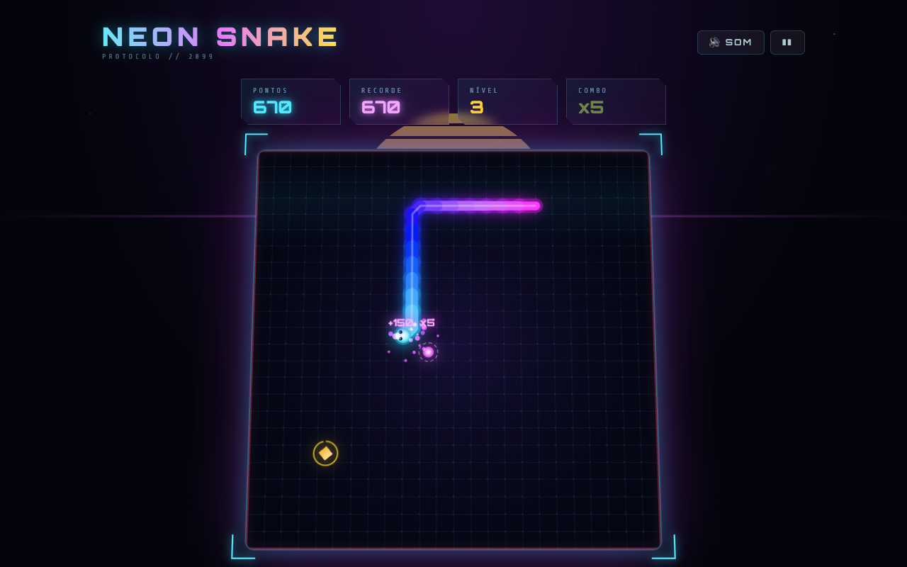

<div align="center">

# Kitumba Games

**Uma coleção de jogos arcade feitos à mão, para jogar no browser.**
Sem instalação, sem contas, sem anúncios. Abres o link e jogas.


</div>

---

## Porquê este repositório

Os jogos clássicos (a cobrinha, os blocos que caem, os tijolos para partir) são simples de explicar e difíceis de fazer bem. Este repositório é o sítio onde os recrio, um de cada vez, com três objetivos:

- **Aprender a fazer jogos a sério com tecnologia web.** Game loops com passo fixo, renderização em canvas, áudio sintetizado com a Web Audio API, input de teclado e de toque. Tudo sem motor de jogo, para perceber cada peça.
- **Ter jogos bons de jogar, em qualquer ecrã.** Cada jogo tem de funcionar bem no computador e no telemóvel, carregar depressa e dar boa sensação ao jogar: som, animação, feedback.
- **Juntar tudo num só sítio.** Em vez de um repositório e um site por jogo, o Kitumba Games é uma única app com um catálogo. Os jogos partilham o mesmo visual neon e a mesma base, e cada um é carregado só quando é aberto.

O nome vem de quem os faz: Kitumba.

## Jogos

| Jogo | Rota | Descrição | Documentação |
|---|---|---|---|
| **Kitumba Snake** | `/snake` | O clássico jogo da cobrinha com visual neon, combos, bónus dourado, níveis e música synthwave | [docs/games/kitumba-snake](docs/games/kitumba-snake/README.md) |

Mais jogos vão entrar nesta lista.

<p align="center">
  
</p>

## Começar

Requisitos: **Node.js 20+** e **pnpm**.

```bash
pnpm install     # instalar dependências
pnpm dev         # servidor de desenvolvimento (http://localhost:5173)
pnpm build       # type-check + build de produção em dist/
pnpm preview     # servir o build localmente
pnpm lint        # ESLint
```

Antes do build, define o domínio público em [`.env`](.env). Os URLs absolutos das meta tags, do JSON-LD e do sitemap vêm daqui, e o build falha de propósito se estiver vazio:

```
VITE_SITE_URL=https://o-teu-dominio.com
```

O resultado é um site estático em `dist/`. Como a app usa rotas reais (`/snake`), o alojamento tem de redirecionar todos os caminhos para o `index.html`. Vê [Publicar com rotas](docs/adicionar-um-jogo.md#publicar-com-rotas).

## Documentação

Tudo o que é técnico está em [docs/](docs/README.md):

- [Adicionar um jogo](docs/adicionar-um-jogo.md): estrutura das rotas, registo de jogos e publicação;
- [Kitumba Snake](docs/games/kitumba-snake/README.md): regras, pontuação, controlos, arquitetura e comportamentos conhecidos.
