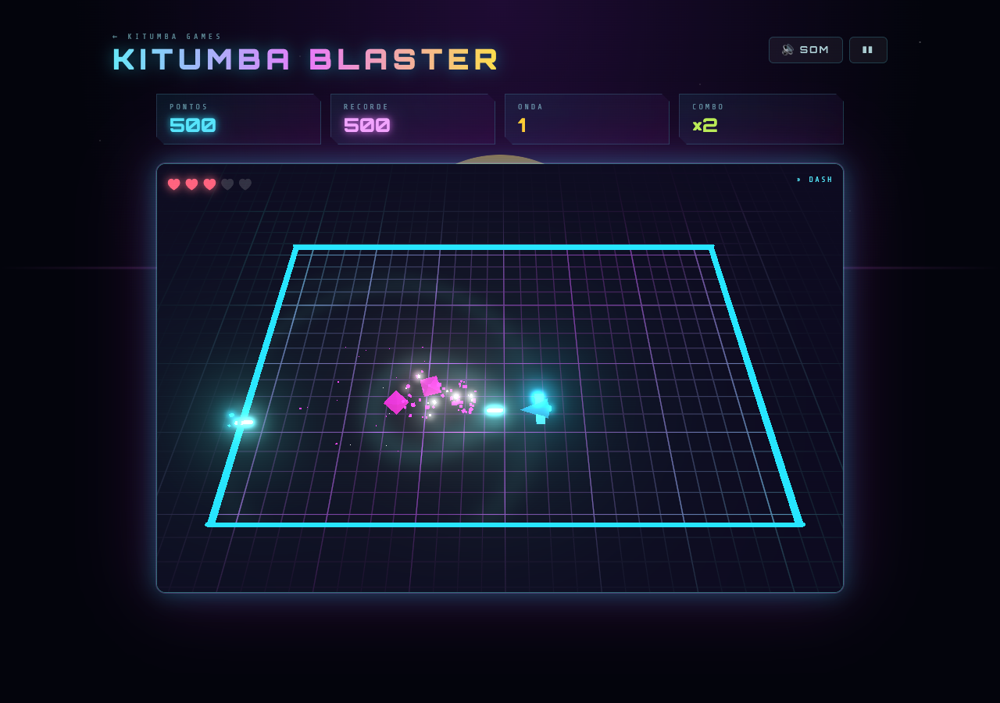
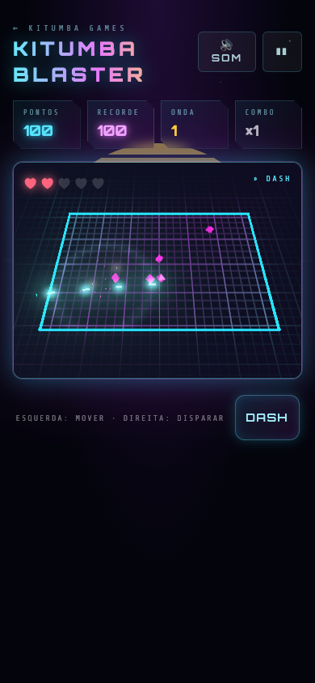

<div align="center">

# Kitumba Blaster

<sub>[← Kitumba Games](../../../README.md) · rota <code>/blaster</code></sub>

**Tiros numa arena neon em 3D, feita com Three.js.**
Move-te, aponta e dispara contra ondas de inimigos cada vez maiores. Encadeia abates para subir o combo e usa o dash para atravessar o perigo.

</div>

---

## Índice

1. [Capturas de ecrã](#capturas-de-ecrã)
2. [Como jogar](#como-jogar)
3. [Regras do jogo](#regras-do-jogo)
4. [Pontuação](#pontuação)
5. [Efeitos sonoros](#efeitos-sonoros)
6. [Arquitetura técnica](#arquitetura-técnica)
7. [Three.js e desempenho](#threejs-e-desempenho)
8. [Ajustar a jogabilidade](#ajustar-a-jogabilidade)

---

## Capturas de ecrã

<table>
  <tr>
    <td width="66%"></td>
    <td width="34%"></td>
  </tr>
  <tr>
    <td align="center"><b>Em jogo</b><br/><sub>Tiros e explosões com bloom; o chão ondula a cada abate</sub></td>
    <td align="center"><b>Telemóvel</b><br/><sub>Dois joysticks virtuais e botão de dash</sub></td>
  </tr>
</table>

---

## Como jogar

| Ação | Teclado + rato | Telemóvel / tátil |
|---|---|---|
| Mover | `W` `A` `S` `D` | Arrastar na metade esquerda da arena |
| Apontar e disparar | Mover o rato e manter o botão, ou `↑` `↓` `←` `→` | Arrastar na metade direita da arena |
| Dash | `Espaço` ou `Shift` | Botão **Dash** |
| Começar / reiniciar | `Enter` ou `Espaço` | Botão **Combater** / **Reiniciar** |
| Pausar / retomar | `P` ou `Esc` | Botão `❚❚` / `▶` no topo |
| Ligar / desligar som | `M` | Botão **Som** no topo |

As setas apontam e disparam ao mesmo tempo, por isso o jogo também se joga só com o teclado. O jogo pausa sozinho quando a janela perde o foco.

---

## Regras do jogo

Os valores vêm das constantes no topo de [src/games/blaster/engine.ts](../../../src/games/blaster/engine.ts). A arena mede **26 × 17** unidades.

### Nave

| Regra | Valor |
|---|---|
| Velocidade | 9 unidades/s |
| Vida | começa com **3**, máximo **5** |
| Cadência de tiro | 9 tiros/s (18 com ⚡ Rápido) |
| Dash | 0,16 s a 30 unidades/s, recarrega em 0,9 s, **invencível** durante o dash |
| Depois de levar dano | 1,6 s invencível (a nave pisca) |

Levar dano lança uma **onda de choque**: apaga todos os projéteis inimigos e empurra os inimigos num raio de 5 unidades, para que um toque nunca se transforme numa sequência de toques.

### Inimigos

| Inimigo | Forma | Vida | Comportamento | Pontos |
|---|---|---|---|---|
| Drone | Octaedro rosa | 1 | Persegue a nave | 100 |
| Investida | Seta laranja | 2 | Aproxima-se, pára a piscar 0,5 s e carrega em linha reta | 150 |
| Atirador | Anel verde | 3 | Fica a 7–10 unidades, anda à volta e dispara orbes (pisca antes de disparar) | 250 |
| Tanque | Cubo violeta | 9 | Lento e pesado, quase não recua com os tiros | 450 |

Os inimigos aparecem num **anel de aviso** que se fecha durante 0,9 s, nunca a menos de 7 unidades da nave.

### Ondas

| Onda | Composição |
|---|---|
| N | `5 + 2N` drones |
| a partir da 2 | `+ N` investidas |
| a partir da 3 | `+ N − 2` atiradores |
| a partir da 4 | `+ ⌊(N − 2) / 2⌋` tanques |

- Os inimigos entram em grupos de `2 + ⌊N/2⌋`, a cada `max(0,7; 2,2 − 0,1·N)` segundos, sem passar de `min(40, 14 + 2N)` vivos.
- A velocidade dos inimigos sobe 4% por onda, até +45%.
- Quando a onda fica vazia há 2,6 s de pausa antes da seguinte.

### Power-ups

Cada inimigo tem uma probabilidade de largar um power-up (5% drone, 8% investida, 12% atirador, 50% tanque). Ficam 9 s no chão e piscam nos últimos 2.

| Power-up | Cor | Efeito |
|---|---|---|
| ✶ Triplo | rosa | 3 tiros em leque durante 9 s |
| ⚡ Rápido | amarelo | Cadência a dobrar durante 9 s |
| ◈ Escudo | verde | Absorve um toque |
| ♥ Vida | vermelho | +1 de vida (só aparece se não estiveres no máximo) |

Triplo e Rápido não se acumulam: apanhar um substitui o outro.

---

## Pontuação

| Fonte | Pontos |
|---|---|
| Abate | pontos do inimigo × combo |
| Onda limpa | `250 × N` |

- **Combo:** cada abate a menos de 2 s do anterior conta para a sequência. O multiplicador é `1 + ⌊sequência / 4⌋`, até **×8**. Levar dano repõe-no a ×1.
- O recorde fica no `localStorage` em `kitumba-blaster:best`.

---

## Efeitos sonoros

Todos os sons são sintetizados com a Web Audio API em [src/games/blaster/audio.ts](../../../src/games/blaster/audio.ts).

| Evento | Som | Efeito visual |
|---|---|---|
| Começar | Carga a subir e acorde | — |
| Disparo | Laser curto (no máximo um a cada 50 ms, para o tiro rápido não saturar) | Projétil com bloom |
| Acertar | Estalido de ruído | Faíscas e inimigo pisca a branco |
| Abate | Explosão (maior no tanque) | Partículas, onda de luz no chão, ecrã treme |
| Tiro inimigo | Tom triangular a descer | Orbe laranja |
| Dash | Sopro de ruído a subir | Rasto de partículas |
| Power-up | Arpejo ascendente | Partículas da cor do power-up |
| Dano | Serra a cair e ruído | Chão a vermelho, onda de choque, nave pisca |
| Nova onda | Arpejo menor | "ONDA N" |
| Fim de jogo | Explosão longa e notas descendentes | Nave explode |

---

## Arquitetura técnica

```
src/games/blaster/
├── BlasterPage.tsx  # Página da rota /blaster: HUD, painéis, teclado, rato, joysticks tácteis
├── engine.ts        # Regras, IA, colisões e cena Three.js
└── audio.ts         # Efeitos sintetizados
```

- **`BlasterGame` (engine.ts)** não depende do React. Recebe um contentor e uma callback `onChange(hud)`, e cria o seu próprio `<canvas>` (assim um remount do React StrictMode nunca reaproveita um contexto WebGL já libertado).

  | Método | Descrição |
  |---|---|
  | `start()` | Reinicia e começa a onda 1 |
  | `togglePause()` | Alterna entre `playing` ↔ `paused` |
  | `setMove(x, z)` | Vetor de movimento (teclado ou joystick esquerdo) |
  | `setAim(x, z)` | Vetor de mira; enquanto não for zero, dispara |
  | `setPointer(clientX, clientY)` / `setTrigger(bool)` | Mira com o rato e botão premido |
  | `dash()` | Dash na direção do movimento, ou da mira se estiveres parado |
  | `setQuality('auto' \| 'high' \| 'low')` | Qualidade gráfica |
  | `destroy()` | Pára o loop e liberta geometrias, materiais e o contexto WebGL |

- A física corre em **sub-passos fixos de 1/120 s** dentro de cada frame, para que os tiros (26 unidades/s) não atravessem inimigos em frames lentos.
- A mira do rato é um raio da câmara intersetado com o plano à altura da nave, por isso aponta certo mesmo com a perspetiva inclinada.
- O HUD só é enviado ao React quando muda. Os joysticks tácteis mexem no DOM por `ref`, sem re-renderizar o React a cada movimento.

---

## Three.js e desempenho

Este é o primeiro jogo 3D do projeto e serviu para avaliar se o Three.js compensa. Conclusão: **compensa**, desde que se sigam as regras abaixo.

### Custo no bundle

| Chunk | Tamanho (gzip) |
|---|---|
| `BlasterPage` (inclui Three.js e pós-processamento) | ~152 KB |
| Outros jogos (cada) | ~9 KB |

O Three.js só é descarregado quando alguém abre `/blaster` (o jogo usa `lazy`), por isso a página inicial e os outros jogos não ficam mais pesados. O Vite avisa que o chunk passa de 500 KB sem compressão; é esperado.

### O que mantém o jogo leve

| Técnica | Porquê |
|---|---|
| `InstancedMesh` para inimigos, tiros, partículas, avisos e power-ups | Uma draw call por tipo, tenha 1 ou 700 instâncias. A cena inteira são ~20 draw calls. |
| Pools de tamanho fixo (`Pool<T>`) | Zero alocações durante o jogo, logo sem pausas do garbage collector |
| Geometria low-poly com `flatShading` | Visual "neon facetado" com poucos triângulos |
| 2 luzes globais + 1 luz pontual | Iluminação barata; os objetos brilhantes usam `MeshBasicMaterial`, que nem calcula luz |
| Chão num shader próprio | Grelha, ondas de choque e tom vermelho de dano num só material, sem texturas |
| Bloom só no que importa | As cores acima de 1 (tiros, explosões, power-ups) passam o limiar de 0,8; paredes e chão ficam abaixo, senão o bloom espalhava um véu por todo o ecrã |
| Sem antialias nativo | Com pós-processamento o MSAA do canvas não serve; o bloom suaviza as arestas |
| Pausa não renderiza | Com o jogo em pausa o GPU descansa (só volta a desenhar se o tamanho mudar) |

### Qualidade adaptativa

A qualidade escolhe-se no menu ou na pausa e fica em `kitumba-blaster:quality`.

| Nível | Bloom | Resolução | Quando |
|---|---|---|---|
| 2 · bloom HD | sim | até 2× o pixel ratio | Arranque em "Auto" num computador, ou "Alto" |
| 1 · bloom | sim | 1× | Arranque em "Auto" num ecrã tátil |
| 0 · sem bloom | não | 1× | "Baixo", ou "Auto" depois de descer |

Em **Auto**, o jogo mede o tempo médio de frame em janelas de 2 s. Se passar de 21 ms (abaixo de ~48 fps), desce um nível. O primeiro segundo depois de começar ou retomar não conta, para que a compilação dos shaders não force uma descida.

Medido num MacBook com Apple M4 (Chrome, 1280 × 900): **60 fps estáveis no nível 2**, sem descidas automáticas.

---

## Ajustar a jogabilidade

Constantes no topo de [src/games/blaster/engine.ts](../../../src/games/blaster/engine.ts):

| Constante | Valor | Efeito |
|---|---|---|
| `ARENA_X` / `ARENA_Z` | 13 / 8,5 | Metade da largura e da profundidade da arena |
| `PLAYER_SPEED` | 9 | Velocidade da nave |
| `START_HP` / `MAX_HP` | 3 / 5 | Vida inicial e máxima |
| `FIRE_DELAY` / `RAPID_DELAY` | 0,11 / 0,055 | Segundos entre tiros |
| `BULLET_SPEED` / `BULLET_LIFE` | 26 / 0,8 | Velocidade e duração dos tiros |
| `DASH_SPEED` / `DASH_TIME` / `DASH_COOLDOWN` | 30 / 0,16 / 0,9 | Dash |
| `INVULN` | 1,6 | Invencibilidade depois de levar dano |
| `POWER_TIME` / `PICKUP_LIFE` | 9 / 9 | Duração dos power-ups e tempo no chão |
| `COMBO_WINDOW` | 2 | Segundos para manter a sequência |
| `ENEMIES` | ver [Inimigos](#inimigos) | Vida, velocidade, raio, pontos, cor e probabilidade de power-up |
| `MAX_*` | — | Tamanho das pools e limite do que o GPU desenha |

A composição das ondas está em `startWave()` e o ritmo de entrada em `step()`.
