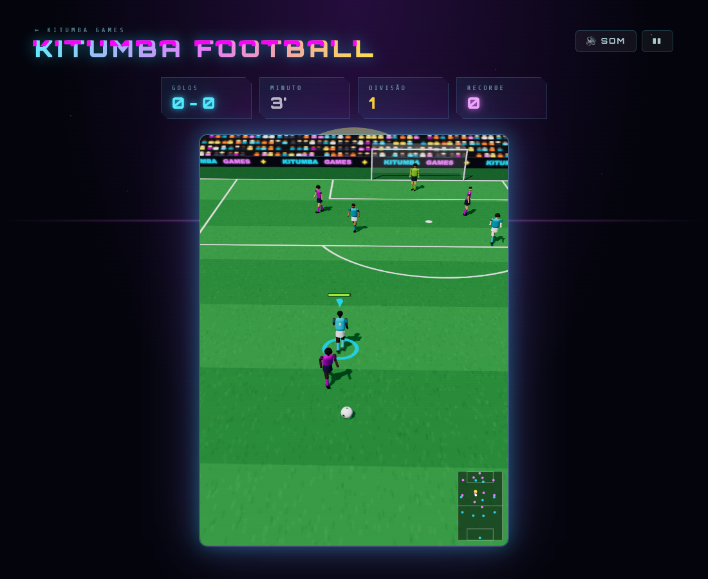
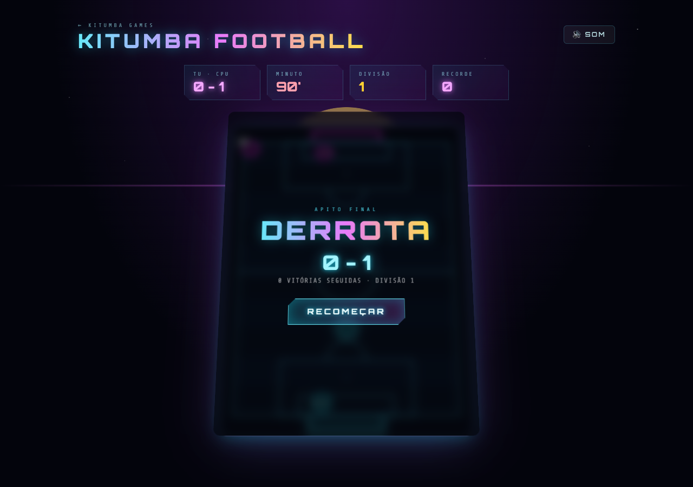
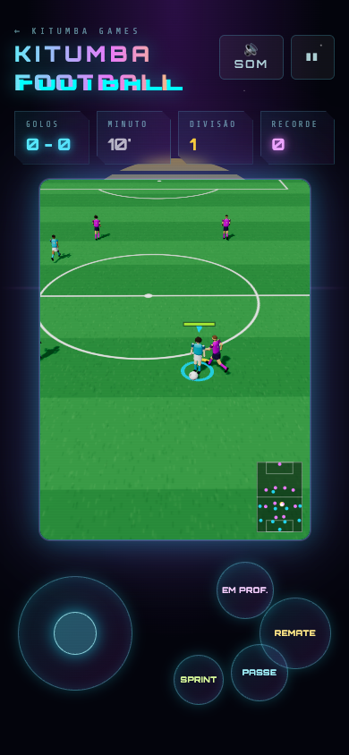

<div align="center">

# Kitumba Football

<sub>[← Kitumba Games](../../../README.md) · rota <code>/football</code></sub>

**Futebol 11 contra 11 em 3D, num estádio neon à noite.**
Controlas a tua equipa inteira à maneira dos jogos de futebol para telemóvel: joystick para conduzir e botões de passe, remate, passe em profundidade e sprint que mudam de função quando defendes. Ganha o jogo e sobe de divisão; cada divisão traz um rival com outro equipamento, mais rápido e mais certeiro.

</div>

---

## Índice

1. [Capturas de ecrã](#capturas-de-ecrã)
2. [Como jogar](#como-jogar)
3. [Regras do jogo](#regras-do-jogo)
4. [Divisões e recorde](#divisões-e-recorde)
5. [Efeitos sonoros](#efeitos-sonoros)
6. [Arquitetura técnica](#arquitetura-técnica)
7. [Ajustar a jogabilidade](#ajustar-a-jogabilidade)

---

## Capturas de ecrã

<table>
  <tr>
    <td width="40%"></td>
    <td width="40%"></td>
    <td width="20%"></td>
  </tr>
  <tr>
    <td align="center"><b>Em jogo</b><br/><sub>11 contra 11; controlas o jogador com o anel</sub></td>
    <td align="center"><b>Apito final</b><br/><sub>Resultado, vitórias seguidas e divisão</sub></td>
    <td align="center"><b>Telemóvel</b><br/><sub>Joystick e quatro botões de ação</sub></td>
  </tr>
</table>

---

## Como jogar

A tua equipa (ciano) ataca a **baliza do fundo do ecrã**. Controlas o jogador com o anel e a seta por cima da cabeça; a barra verde é a energia dele. Os outros dez, os guarda-redes e o rival são controlados pela IA.

| Ação | Teclado | Telemóvel / tátil |
|---|---|---|
| Correr / conduzir a bola | `↑` `↓` `←` `→` ou `W` `A` `S` `D` | Joystick |
| Sprint (gasta energia) | `Shift` (manter) | **SPRINT** (manter) |
| Com bola: passe · Sem bola: trocar de jogador | `Espaço` ou `J` | **PASSE** / **TROCAR** |
| Com bola: remate · Sem bola: carrinho | `K` ou `X` (manter para carregar) | **REMATE** / **CARRINHO** |
| Com bola: passe em profundidade · Sem bola: pressão de um colega | `L` ou `C` | **EM PROF.** / **PRESSÃO** |
| Começar / próximo jogo | `Enter` ou `Espaço` | **Apito inicial** / **Próximo jogo** |
| Pausar / retomar | `P` ou `Esc` | `❚❚` / `▶` |
| Som | `M` | **Som** |

- **Passe**: vai para o colega na direção do joystick (ou para onde estás virado). Passes longos (mais de 26 m) vão pelo ar. O controlo passa logo para quem recebe, que corre para a bola sozinho até mexeres no joystick.
- **Remate**: manter carrega a força (barra por cima do jogador). O joystick para os lados escolhe o canto; sem joystick, remata para o lado que o guarda-redes não cobre. Força a mais (barra vermelha) de longe vai por cima da barra.
- **Bolas paradas**: lançamentos, cantos e pontapés de saída esperam por ti — aponta com o joystick e passa. No canto, **REMATE** cruza para a área.
- **Defender**: correr contra quem tem a bola tenta desarmá-lo (por trás é mais difícil). O carrinho ganha a bola se lhe chegar, mas depois ficas no chão uns instantes.

---

## Regras do jogo

Valores no topo de [src/games/football/engine.ts](../../../src/games/football/engine.ts). A unidade é o metro.

- Campo de 52 × 80 m, baliza de 7,6 × 2,44 m. 4-4-2 para as duas equipas.
- Cada jogo dura **180 s** reais (90 minutos no HUD), com **intervalo** aos 45' e pontapé de saída do CPU na 2.ª parte.
- Há **lançamentos, cantos e pontapés de baliza**. Não há foras de jogo nem faltas.
- A bola tem altura e gravidade: passes pelo ar passam por cima dos defesas, remates podem ir à barra ou por cima, e há **postes** e **barra**.
- Bolas rápidas podem ressaltar de quem tenta controlá-las, a não ser que sejam para ele.
- Os guarda-redes cortam o ângulo, **mergulham** a remates fora do alcance, agarram ou desviam, e saem a bolas soltas na área. Depois de agarrar, repõem com um passe.
- No fim aparece a **posse de bola** de cada equipa.

---

## Divisões e recorde

| Resultado | Efeito |
|---|---|
| Vitória | +1 vitória seguida e sobes uma divisão |
| Empate | Ficas na mesma divisão; a série mantém-se |
| Derrota | A série volta a 0 e voltas à divisão 1 |

Cada divisão acima da 1 torna o CPU mais rápido, mais certeiro no passe e no remate, mais agressivo a desarmar (a partir da 3.ª pressiona com dois jogadores) e com um guarda-redes de melhores reflexos. O rival muda de equipamento a cada divisão.

O **recorde** é a maior série de vitórias seguidas. Fica no `localStorage`, na chave `kitumba-football:best`.


---

## Efeitos sonoros

Todos os sons são sintetizados com a Web Audio API em [src/games/football/audio.ts](../../../src/games/football/audio.ts). Não há ficheiros de áudio.

| Evento | Som | Efeito visual |
|---|---|---|
| Público (contínuo) | Ruído filtrado baixinho, tipo murmúrio de estádio | — |
| Apito inicial / recomeço | Apito de árbitro (seno agudo com trilo rápido) | "PONTAPÉ DE SAÍDA" |
| Chuto | Pancada grave e estalo; mais forte quanto mais forte o chuto | Faísca na cor da equipa (só remates) |
| Chuto falhado | "Swish" de ar | — |
| Ressalto na linha | Toque grave curto | — |
| Poste | Três tons metálicos e um "uh" do público | Ecrã treme um pouco |
| Golo teu | Rugido do público a subir e fanfarra | "GOLO!", confetti, flash ciano; o marcador corre para a bandeirola e a equipa festeja |
| Golo do CPU | Lamento do público e notas a descer | "GOLO CPU", flash magenta |
| Defesa / carrinho | Ressalto / "swish" | "DEFESA!" / "CARRINHO!" |
| Apito final | Três apitos | Painel de resultado |
| Vitória | Fanfarra depois do apito final | — |
| Pausa | Duas notas descendentes | Painel de pausa |

O público cala-se na pausa, no fim do jogo e ao sair da página.

---

## Arquitetura técnica

```
src/games/football/
├── FootballPage.tsx  # Página da rota /football: HUD, painéis, teclado, joystick e botões táteis
├── engine.ts         # Simulação (bola com altura, posse, IA das equipas e guarda-redes), câmara e overlay
├── humanoid.ts       # Jogador 3D articulado (anca, joelhos, ombros, cotovelos) e as suas poses
├── stadium.ts        # Relvado com marcações, balizas com rede, placas publicitárias, bancadas e torres de luz
└── audio.ts          # Público, apito e efeitos sintetizados
```

- **`FootballGame` (engine.ts)** não depende do React. Recebe o `<canvas>` WebGL, um `<canvas>` 2D por cima (radar, barras, letreiros, confetti) e uma callback `onChange(hud)`:

  | Método | Descrição |
  |---|---|
  | `start()` | Começa um jogo na divisão atual |
  | `togglePause()` | Alterna entre `playing` ↔ `paused` |
  | `setInput(x, y)` | Vetor de movimento, cada eixo entre -1 e 1 |
  | `press(action, down)` | Botão `pass`, `shoot`, `through` ou `sprint` carregado ou largado |
  | `destroy()` | Pára o loop e liberta a cena |

- A simulação é 2D (x, y no relvado) mais a altura da bola, em sub-passos fixos de 1/120 s. A cena three.js só a desenha: cada jogador é um `Humanoid` com geometria partilhada e poses (corrida, remate, carrinho, mergulho, festejo) calculadas por frame.
- A IA mantém a forma do 4-4-2 deslocada com a bola, marca atacantes perto da sua zona, e escolhe passes pela linha livre, espaço do recetor e progressão.
- O HUD só é enviado ao React quando muda; `attacking` troca os nomes dos botões.

---

## Ajustar a jogabilidade

Constantes no topo de [src/games/football/engine.ts](../../../src/games/football/engine.ts):

| Constante | Valor | Efeito |
|---|---|---|
| `RUN_SPEED` / `SPRINT_SPEED` | 6.4 / 8.6 | Velocidade a correr e em sprint (m/s) |
| `DRIBBLE` | 0.9 | Multiplicador de velocidade com a bola |
| `ROLL_FRICTION` / `AIR_DRAG` | 0.85 / 0.08 | Quanto a bola trava no chão e no ar |
| `CONTROL_R` / `TACKLE_R` | 0.8 / 1.15 | Distância para dominar a bola e para desarmar |
| `SHOT_CHARGE` | 0.85 | Segundos para um remate de força máxima |
| `MATCH_TIME` | 180 | Duração do jogo em segundos |
| `FORMATION` | 4-4-2 | Posições base, em fração do campo |

A dificuldade por divisão está em `cpuPace()`, `tackles()`, `saves()`, `shoot()` e `passBall()`.
