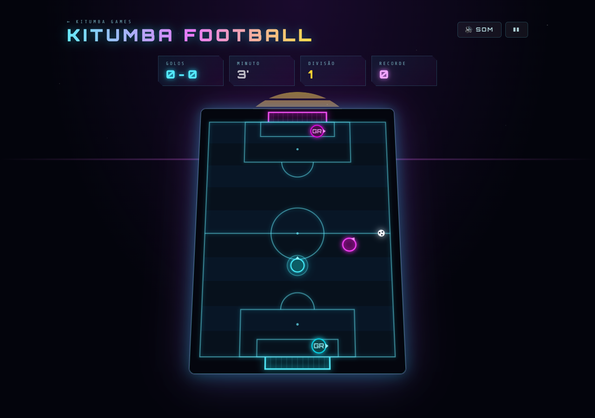
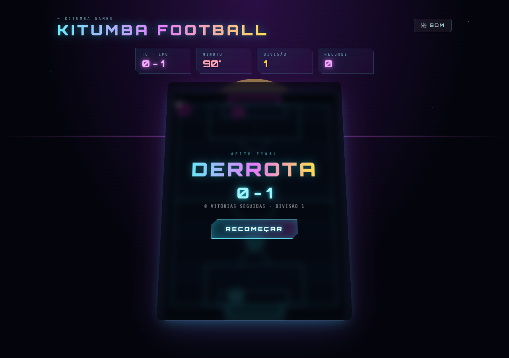
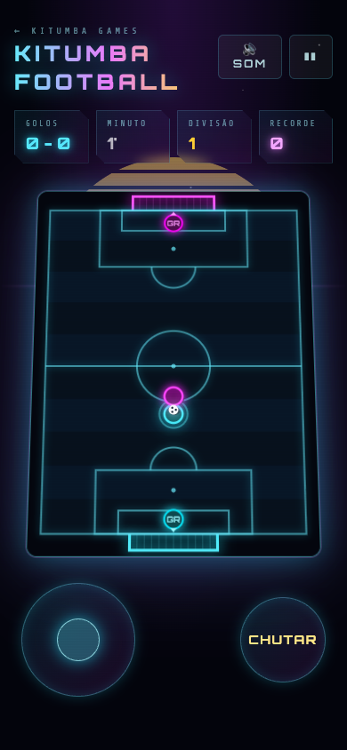

<div align="center">

# Kitumba Football

<sub>[← Kitumba Games](../../../README.md) · rota <code>/football</code></sub>

**Futebol arcade num estádio neon, visto de cima.**
Tu contra o CPU, cada um com um guarda-redes automático. Dribla, chuta, ganha o jogo e sobe de divisão. Cada divisão traz um adversário mais rápido e um guarda-redes com melhores reflexos.

</div>

---

## Índice

1. [Capturas de ecrã](#capturas-de-ecrã)
2. [Como jogar](#como-jogar)
3. [Regras do jogo](#regras-do-jogo)
4. [Divisões e recorde](#divisões-e-recorde)
5. [Efeitos sonoros](#efeitos-sonoros)
6. [Arquitetura técnica](#arquitetura-técnica)
7. [Ajustar a jogabilidade](#ajustar-a-jogabilidade)

---

## Capturas de ecrã

<table>
  <tr>
    <td width="40%"></td>
    <td width="40%"></td>
    <td width="20%"></td>
  </tr>
  <tr>
    <td align="center"><b>Em jogo</b><br/><sub>Tu (ciano, com anel) e o teu GR em baixo; o CPU (magenta) ataca para baixo</sub></td>
    <td align="center"><b>Apito final</b><br/><sub>Resultado, vitórias seguidas e divisão</sub></td>
    <td align="center"><b>Telemóvel</b><br/><sub>Joystick e botão CHUTAR</sub></td>
  </tr>
</table>

---

## Como jogar

Controlas o jogador ciano com o anel à volta. Atacas a **baliza de cima** (magenta) e defendes a de baixo. Os dois guarda-redes (`GR`) jogam sozinhos.

| Ação | Teclado | Telemóvel / tátil |
|---|---|---|
| Correr (8 direções) | `↑` `↓` `←` `→` ou `W` `A` `S` `D` | Arrastar o joystick |
| Chutar | `Espaço`, `K` ou `X` | Botão **CHUTAR** |
| Começar / próximo jogo | `Enter` ou `Espaço` | Botão **Apito inicial** / **Próximo jogo** |
| Pausar / retomar | `P` ou `Esc` | Botão `❚❚` / `▶` no topo |
| Ligar / desligar som | `M` | Botão **Som** no topo |

O joystick e o botão **CHUTAR** só aparecem em ecrãs com menos de 768px de largura. Ao contrário dos outros jogos, o `Espaço` não pausa: durante o jogo é o chuto.

---

## Regras do jogo

Os valores vêm das constantes no topo de [src/games/football/engine.ts](../../../src/games/football/engine.ts). A unidade de medida é **1/10 da largura do campo**; o comprimento segue a proporção 3:4 do canvas (cerca de 13,3 unidades).

### Jogo

- Cada jogo dura **90 s** reais, mostrados no HUD como 90 minutos.
- Depois de cada golo há um **pontapé de saída**: todos voltam ao seu meio-campo, a bola vai para o centro e o jogo fica parado ~2 s. Esse tempo não conta para o relógio.
- Não há foras nem cantos. A bola ressalta nas linhas (perde 30% da velocidade) e só entra pela boca da baliza.

### Bola e jogadores

| Regra | Valor |
|---|---|
| Largura da baliza | 3 |
| Velocidade do jogador | 4,3/s |
| Força do chuto | 10/s |
| Alcance do chuto | 0,38 além do contacto |
| Intervalo entre chutos | 0,3 s |
| Atrito da bola | perde ~67% da velocidade por segundo |

- **Driblar**: correr contra a bola empurra-a. Não há posse: quem lhe tocar leva-a.
- **Chutar** atira a bola na direção para onde estás virado (a seta no jogador). Chutar sem a bola ao alcance faz só um "swish".
- **Ajuda de pontaria**: se estás virado para a baliza do CPU e o remate ia sair ao lado por menos de 1,5, é corrigido para dentro do poste mais próximo. Um remate já apontado à baliza não é mexido.

### CPU

- Põe-se atrás da bola (do lado contrário à tua baliza) e conduz com toques curtos na direção da baliza. Se estiver do lado errado, contorna a bola em vez de a chutar para trás.
- Remata quando está a menos de `4 + 0,3 × divisão` da baliza, e às vezes de mais longe (até 7). Aponta a um ponto aleatório da baliza; nas primeiras divisões falha mais.

### Guarda-redes

- Ficam na linha de golo, entre a bola e o meio da baliza, deixando os cantos descobertos.
- Saem à bola quando ela está **solta** (lenta) na área, e afastam-na para a frente, para um dos lados.
- Um **remate** só é defendido se bater no corpo do guarda-redes. Durante um remate ele só reage a uma fração da velocidade: 60% no teu, e no do CPU 30% na divisão 1, +8% por divisão até 90%.

---

## Divisões e recorde

| Resultado | Efeito |
|---|---|
| Vitória | +1 vitória seguida e sobes uma divisão |
| Empate | Ficas na mesma divisão; a série mantém-se |
| Derrota | A série volta a 0 e voltas à divisão 1 |

Cada divisão acima da 1 torna o CPU mais rápido (`3 + 0,25`/s por divisão, até 4,5), o guarda-redes dele mais rápido e com melhores reflexos, e os remates dele mais fortes e certeiros.

O **recorde** é a maior série de vitórias seguidas. Fica no `localStorage`, na chave `kitumba-football:best`.

Medido em simulação, um remate apontado ao canto livre a 2,5–5,5 da baliza entra cerca de 87% das vezes na divisão 1 e 53% na divisão 6.

---

## Efeitos sonoros

Todos os sons são sintetizados com a Web Audio API em [src/games/football/audio.ts](../../../src/games/football/audio.ts). Não há ficheiros de áudio.

| Evento | Som | Efeito visual |
|---|---|---|
| Público (contínuo) | Ruído filtrado baixinho, tipo murmúrio de estádio | — |
| Apito inicial / recomeço | Apito de árbitro (seno agudo com trilo rápido) | "PONTAPÉ DE SAÍDA" |
| Chuto | Pancada grave e estalo; mais forte quanto mais forte o chuto | Faísca na cor da equipa (só remates) |
| Chuto falhado | "Swish" de ar | — |
| Ressalto na linha | Toque grave curto | — |
| Poste | Três tons metálicos e um "uh" do público | Ecrã treme um pouco |
| Golo teu | Rugido do público a subir e fanfarra | "GOLO!", explosão de partículas, flash ciano, ecrã abana |
| Golo do CPU | Lamento do público e notas a descer | "GOLO CPU", flash magenta |
| Apito final | Três apitos | Painel de resultado |
| Vitória | Fanfarra depois do apito final | — |
| Pausa | Duas notas descendentes | Painel de pausa |

O público cala-se na pausa, no fim do jogo e ao sair da página.

---

## Arquitetura técnica

```
src/games/football/
├── FootballPage.tsx  # Página da rota /football: HUD, painéis, teclado, joystick tátil
├── engine.ts         # Física, IA do CPU e dos guarda-redes, renderização no canvas
└── audio.ts          # Público, apito e efeitos sintetizados
```

A estrutura é igual à do [Kitumba Racer](../kitumba-racer/README.md#arquitetura-técnica):

- **`FootballGame` (engine.ts)** não depende do React. Recebe um `<canvas>` e uma callback `onChange(hud)`:

  | Método | Descrição |
  |---|---|
  | `start()` | Começa um jogo na divisão atual (desbloqueia o áudio, apita, liga o público) |
  | `togglePause()` | Alterna entre `playing` ↔ `paused` |
  | `setInput(x, y)` | Vetor de movimento, cada eixo entre -1 e 1 |
  | `kick()` | Chuta, se a bola estiver ao alcance |
  | `destroy()` | Pára o loop, o `ResizeObserver` e o público |

- A página junta as teclas de direção carregadas num vetor (diagonais incluídas). O joystick tátil envia o vetor do toque, com uma pequena zona morta no centro.
- A lógica corre com passo variável, como no Racer, mas cada frame é dividido em sub-passos de no máximo 8 ms para que um remate forte não atravesse jogadores nem linhas.
- O HUD só é enviado ao React quando muda (golos, minuto, modo).

---

## Ajustar a jogabilidade

Constantes no topo de [src/games/football/engine.ts](../../../src/games/football/engine.ts):

| Constante | Valor | Efeito |
|---|---|---|
| `GOAL_W` | 3 | Largura da baliza |
| `PLAYER_SPEED` | 4.3 | Velocidade do teu jogador |
| `CPU_SPEED` / `CPU_SPEED_STEP` / `CPU_MAX_SPEED` | 3 / 0.25 / 4.5 | Velocidade do CPU na divisão 1, aumento por divisão e máximo |
| `GK_SPEED` | 2.3 | Velocidade base dos guarda-redes |
| `KICK_POWER` | 10 | Força do chuto |
| `KICK_REACH` | 0.38 | Distância a que ainda consegues chutar |
| `BALL_FRICTION` | 1.1 | Quanto a bola trava |
| `WALL_BOUNCE` | 0.7 | Velocidade que a bola guarda ao ressaltar |
| `MATCH_TIME` | 90 | Duração do jogo em segundos |

Os reflexos dos guarda-redes estão em `moveKeeper()` e a decisão de rematar do CPU em `moveCpu()`.
