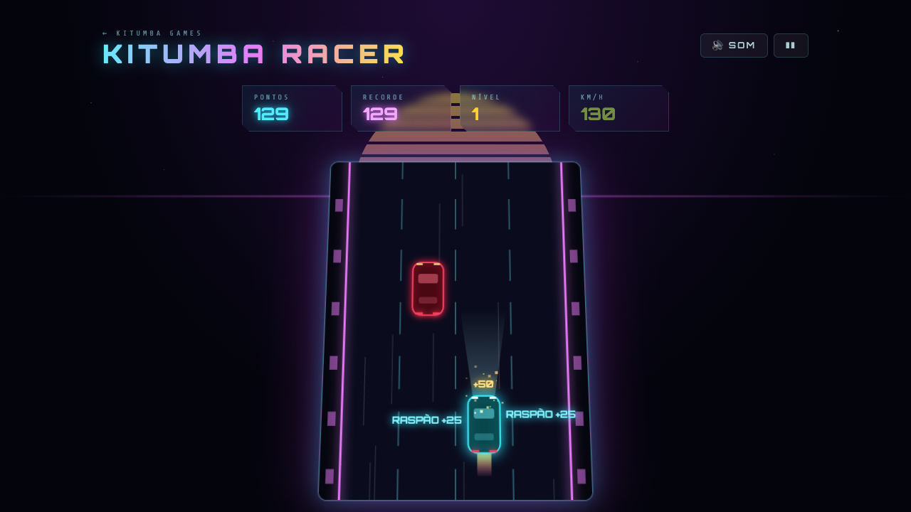
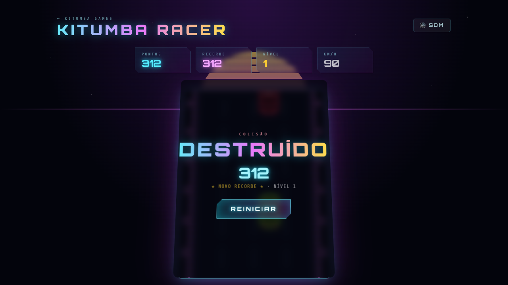

<div align="center">

# Kitumba Racer

<sub>[← Kitumba Games](../../../README.md) · rota <code>/racer</code></sub>

**Corrida numa autoestrada neon, vista de cima.**
Muda de faixa para fugir ao trânsito, carrega no turbo, apanha diamantes e passa rente aos outros carros. Um toque num carro e acabou.

</div>

---

## Índice

1. [Capturas de ecrã](#capturas-de-ecrã)
2. [Como jogar](#como-jogar)
3. [Regras do jogo](#regras-do-jogo)
4. [Pontuação](#pontuação)
5. [Efeitos sonoros](#efeitos-sonoros)
6. [Arquitetura técnica](#arquitetura-técnica)
7. [Ajustar a jogabilidade](#ajustar-a-jogabilidade)

---

## Capturas de ecrã

<table>
  <tr>
    <td width="50%"></td>
    <td width="50%"></td>
  </tr>
  <tr>
    <td align="center"><b>Em jogo</b><br/><sub>Turbo ligado (chama atrás do carro), dois raspões e um diamante apanhado</sub></td>
    <td align="center"><b>Colisão</b><br/><sub>Pontuação final, recorde e nível alcançado</sub></td>
  </tr>
</table>

---

## Como jogar

O teu carro (ciano) anda sempre para a frente. O trânsito vai mais devagar e aparece no topo da estrada. Troca de faixa para não bater.

| Ação | Teclado | Telemóvel / tátil |
|---|---|---|
| Mudar de faixa | `←` `→` ou `A` `D` | Swipe na estrada ou botões `◀` `▶` |
| Turbo (manter) | `↑`, `W` ou `Shift` | Manter o botão `⚡` |
| Começar / reiniciar | `Enter` ou `Espaço` | Botão **Arrancar** / **Reiniciar** |
| Pausar / retomar | `Espaço`, `P` ou `Esc` | Botão `❚❚` / `▶` no topo |
| Ligar / desligar som | `M` | Botão **Som** no topo |

Os botões `◀ ⚡ ▶` só aparecem em ecrãs com menos de 768px de largura.

---

## Regras do jogo

Os valores vêm das constantes no topo de [src/games/racer/engine.ts](../../../src/games/racer/engine.ts). A unidade de medida é a **largura de uma faixa**.

### Estrada e carros

| Regra | Valor |
|---|---|
| Faixas | **4** |
| Faixa inicial | 2.ª a contar da esquerda |
| Tamanho dos carros | 0,56 × 1 faixa |
| Mudança de faixa | Deslizamento a 9 faixas/s (cerca de 0,11 s por faixa) |

### Velocidade

- Velocidade base: **6** faixas/s (mostrada como 90 km/h), mais **0,6** por nível, até **13**.
- O **turbo** multiplica a velocidade por **1,45** enquanto estiver carregado. A velocidade sobe e desce de forma gradual.
- km/h no HUD = velocidade × 15, arredondado a múltiplos de 5.

### Trânsito

- Cada faixa tem uma velocidade fixa (`1,2`, `1,8`, `2,4` e `3` faixas/s, da esquerda para a direita). Como todos os carros da mesma faixa andam ao mesmo ritmo, nunca se sobrepõem.
- O trânsito anda mais devagar que tu, por isso desce no ecrã à **diferença de velocidades**. As faixas da esquerda descem mais depressa.
- Um carro novo aparece a cada `max(0,32, 0,95 − nível × 0,06)` segundos, com uma variação aleatória de ±30%.
- **Há sempre uma saída.** Antes de criar um carro, o jogo calcula quando é que ele chega à tua linha. Se isso fechasse as 4 faixas ao mesmo tempo (com uma margem de 0,5 s), o carro não é criado nessa faixa.

### Colisão

- Bater em qualquer carro acaba o jogo imediatamente.
- A colisão usa caixas retangulares ligeiramente mais pequenas que o desenho (0,07 de margem em cada lado), para que um toque de raspão visual não conte.
- A meio de uma mudança de faixa o carro está entre duas faixas e pode bater em carros de qualquer uma delas.

### Níveis

- Sobes de nível a cada **260 faixas** de distância percorrida (cerca de 40 s sem turbo no início).
- Cada nível aumenta a velocidade base e a frequência do trânsito, e multiplica os pontos.

---

## Pontuação

| Fonte | Pontos |
|---|---|
| Distância | `distância × nível`, a dobrar com o turbo ligado |
| Diamante dourado | `50 × nível` |
| Raspão (passar um carro na faixa ao lado) | `25 × nível` |

- Os diamantes aparecem a cada 1,8 a 3,8 s numa faixa aleatória e estão parados na estrada.
- Um raspão conta quando um carro acaba de passar por ti estando a menos de 1,1 faixas de distância lateral, ou seja, na faixa colada à tua.
- O recorde fica no `localStorage`, na chave `kitumba-racer:best`, e atualiza em tempo real.

---

## Efeitos sonoros

Todos os sons são sintetizados com a Web Audio API em [src/games/racer/audio.ts](../../../src/games/racer/audio.ts). Não há ficheiros de áudio nem música: o som do motor faz de ambiente.

| Evento | Som | Efeito visual |
|---|---|---|
| Arrancar | Três "cranks" do motor de arranque e uma acelerada | — |
| Motor (contínuo) | Dente de serra + quadrada com filtro passa-baixo; o tom e o brilho sobem com a velocidade | — |
| Mudar de faixa | "Swish" de ruído filtrado a subir | — |
| Turbo | Tom a subir e ruído a varrer | Chama no escape e linhas de velocidade |
| Diamante | Duas notas quadradas agudas | Partículas douradas e `+pts` |
| Raspão | Ruído a descer de tom, tipo efeito Doppler | Texto `RASPÃO +pts` e ecrã a tremer um pouco |
| Subir de nível | Arpejo maior em dente de serra | Flash ciano e "NÍVEL N" |
| Colisão | Chiar de pneus, pancada grave, ruído de impacto, três tons metálicos e detritos | Explosão de partículas nas cores dos dois carros, flash vermelho, ecrã abana |
| Pausa | Duas notas descendentes | Painel de pausa |

O motor pára na pausa, na colisão e ao sair da página.

---

## Arquitetura técnica

```
src/games/racer/
├── RacerPage.tsx    # Página da rota /racer: HUD, painéis, teclado, swipe, botões tácteis
├── engine.ts        # Regras, trânsito, colisões e renderização no canvas
└── audio.ts         # Motor contínuo e efeitos sintetizados
```

A estrutura é igual à do [Kitumba Snake](../kitumba-snake/README.md#arquitetura-técnica):

- **`RacerGame` (engine.ts)** não depende do React. Recebe um `<canvas>` e uma callback `onChange(hud)`:

  | Método | Descrição |
  |---|---|
  | `start()` | Reinicia e começa a corrida (desbloqueia o áudio e liga o motor) |
  | `togglePause()` | Alterna entre `playing` ↔ `paused` |
  | `steer(-1 \| 1)` | Muda uma faixa para a esquerda ou para a direita |
  | `setBoost(bool)` | Liga ou desliga o turbo |
  | `destroy()` | Pára o loop, o `ResizeObserver` e o motor |

- O HUD só é enviado ao React quando muda. A velocidade é arredondada a 5 km/h para não provocar uma renderização por frame durante a aceleração.
- Ao contrário do Snake, a lógica corre com **passo variável** (`dt` por frame, limitado a 100 ms), porque o movimento é contínuo e não em células.
- Tudo é calculado em unidades de faixa e convertido em pixels no desenho, por isso o jogo comporta-se igual em qualquer tamanho de ecrã.

---

## Ajustar a jogabilidade

Constantes no topo de [src/games/racer/engine.ts](../../../src/games/racer/engine.ts):

| Constante | Valor | Efeito |
|---|---|---|
| `LANES` | 4 | Número de faixas |
| `LANE_SPEEDS` | `[1.2, 1.8, 2.4, 3]` | Velocidade do trânsito em cada faixa |
| `BASE_SPEED` / `MAX_SPEED` | 6 / 13 | Velocidade inicial e máxima (sem turbo) |
| `BOOST` | 1.45 | Multiplicador do turbo |
| `STEER_SPEED` | 9 | Rapidez da mudança de faixa |
| `LEVEL_DISTANCE` | 260 | Distância por nível |
| `HITBOX_INSET` | 0.07 | Margem de tolerância da colisão |

O intervalo entre carros está em `step()` e a regra da "saída garantida" em `spawnCar()`.
