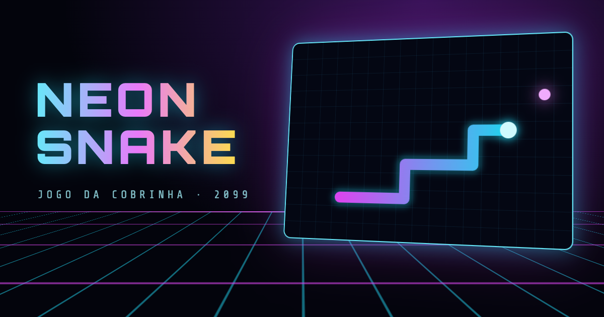
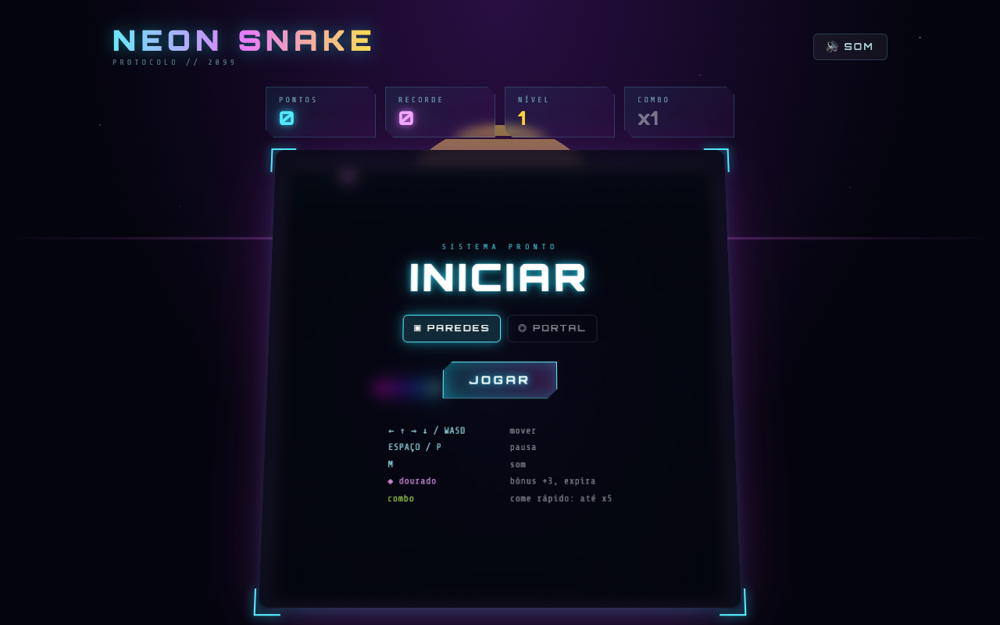
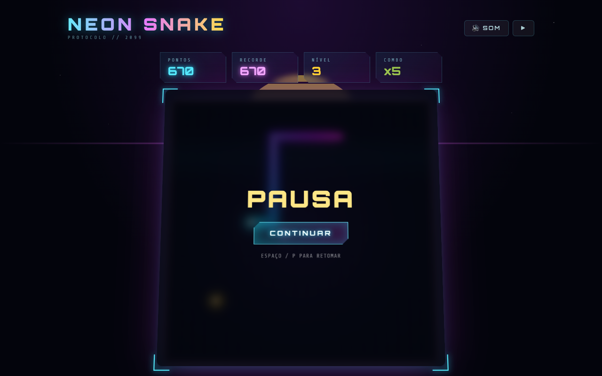
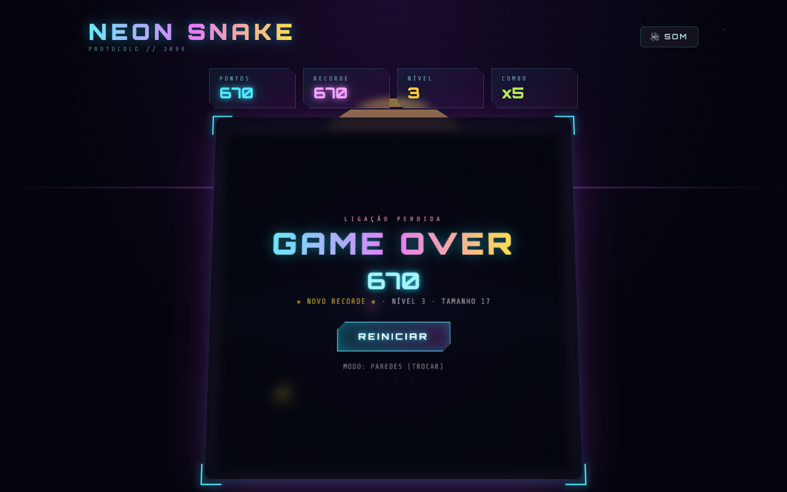
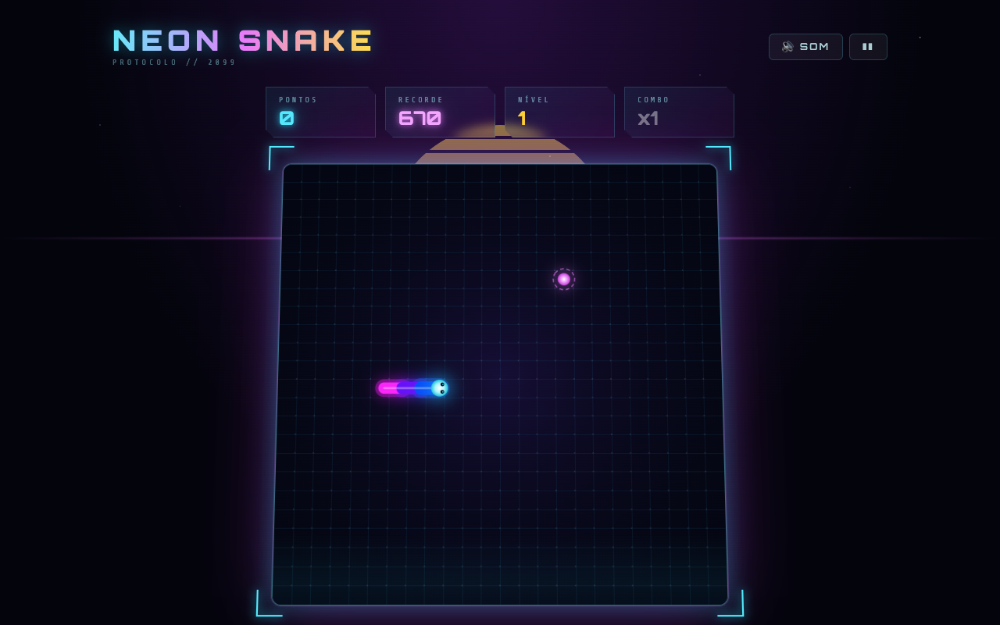
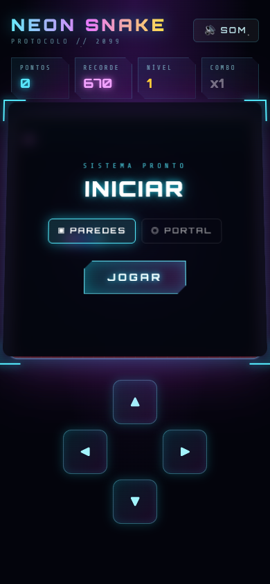
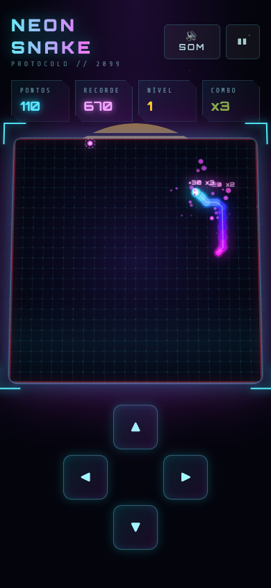
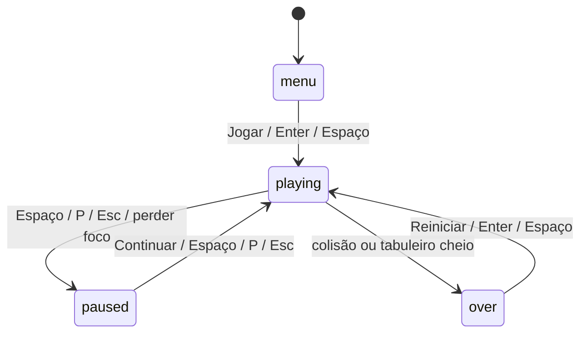

<div align="center">



# Kitumba Snake

<sub>[← Kitumba Games](../../../README.md) · rota <code>/snake</code></sub>

**O clássico jogo da cobrinha, reimaginado com visual neon futurista.**
Corre no browser, sem instalação, com efeitos sonoros sintetizados em tempo real, música synthwave, combos, bónus e controlos para telemóvel.


</div>

---

## Índice

1. [Capturas de ecrã](#capturas-de-ecrã)
2. [Como jogar](#como-jogar)
3. [Regras do jogo](#regras-do-jogo)
   - [Tabuleiro e estado inicial](#tabuleiro-e-estado-inicial)
   - [Movimento e direção](#movimento-e-direção)
   - [Colisões e fim de jogo](#colisões-e-fim-de-jogo)
   - [Modos de jogo](#modos-de-jogo)
   - [Comida e crescimento](#comida-e-crescimento)
   - [Pontuação](#pontuação)
   - [Combo](#combo)
   - [Bónus dourado](#bónus-dourado)
   - [Níveis e velocidade](#níveis-e-velocidade)
   - [Recorde](#recorde)
   - [Pausa](#pausa)
4. [Estados do jogo](#estados-do-jogo)
5. [Feedback visual e sonoro](#feedback-visual-e-sonoro)
6. [Arquitetura técnica](#arquitetura-técnica)
7. [Ajustar a jogabilidade](#ajustar-a-jogabilidade)
8. [Comportamentos conhecidos](#comportamentos-conhecidos)

---

## Capturas de ecrã

<table>
  <tr>
    <td width="50%"></td>
    <td width="50%"></td>
  </tr>
  <tr>
    <td align="center"><b>Menu inicial</b><br/><sub>Escolha do modo (Paredes / Portal) e lista de controlos</sub></td>
    <td align="center"><b>Em jogo</b><br/><sub>Nível 3, combo x5 (+150 pontos por comida) e bónus dourado no tabuleiro</sub></td>
  </tr>
  <tr>
    <td></td>
    <td></td>
  </tr>
  <tr>
    <td align="center"><b>Pausa</b><br/><sub>O tabuleiro fica desfocado por trás do painel</sub></td>
    <td align="center"><b>Game over</b><br/><sub>Pontuação final, recorde, nível e tamanho alcançados</sub></td>
  </tr>
  <tr>
    <td></td>
    <td>
      <table>
        <tr>
          <td></td>
          <td></td>
        </tr>
      </table>
    </td>
  </tr>
  <tr>
    <td align="center"><b>Modo Portal</b><br/><sub>Sem contorno vermelho: as bordas não matam</sub></td>
    <td align="center"><b>Telemóvel</b><br/><sub>Layout vertical com D-pad e suporte a swipe</sub></td>
  </tr>
</table>

---

## Como jogar

Guia a cobra até à **comida** (orbe magenta). Cada vez que come, a cobra cresce e ganhas pontos. Come depressa para encadear **combos**, apanha o **diamante dourado** antes que desapareça e sobrevive o máximo de tempo possível sem bateres nas paredes nem em ti própria.

### Controlos

| Ação | Teclado | Telemóvel / tátil |
|---|---|---|
| Mover | `←` `↑` `→` `↓` ou `W` `A` `S` `D` | Swipe no tabuleiro ou D-pad no ecrã |
| Começar / reiniciar | `Enter` ou `Espaço` (no menu e no game over) | Botão **Jogar** / **Reiniciar** |
| Pausar / retomar | `Espaço`, `P` ou `Esc` | Botão `❚❚` / `▶` no topo |
| Ligar / desligar som | `M` | Botão **Som** no topo |

> O D-pad só aparece em ecrãs com menos de 768px de largura. Em desktop, o tabuleiro inclina-se em 3D seguindo o rato.

---

## Regras do jogo

As regras estão todas em [src/games/snake/engine.ts](../../../src/games/snake/engine.ts). Os valores abaixo vêm das constantes desse ficheiro.

### Tabuleiro e estado inicial

| Regra | Valor |
|---|---|
| Tamanho do tabuleiro | **24 × 24** células |
| Tamanho inicial da cobra | **4** segmentos |
| Posição inicial da cabeça | coluna 8, linha 12 (meio do lado esquerdo) |
| Direção inicial | **direita** |
| Primeira comida | numa célula livre aleatória |
| Pontos / nível / combo iniciais | 0 / 1 / x1 |

### Movimento e direção

- A cobra anda **uma célula por tick**. A duração do tick depende do [nível](#níveis-e-velocidade).
- As teclas carregadas vão para uma **fila de direções** com até **3** entradas, e cada tick consome uma. Assim, viragens rápidas (por exemplo `↑` e logo `←`) não se perdem mesmo que aconteçam dentro do mesmo tick.
- Uma direção é **ignorada** se:
  - for o **oposto** da última direção na fila, ou da atual se a fila estiver vazia (não se pode inverter sobre o próprio corpo);
  - for **igual** à última direção na fila;
  - a fila já tiver 3 entradas;
  - o jogo não estiver no estado `playing`.
- Cada direção aceite toca um pequeno "tick" sonoro.

### Colisões e fim de jogo

O jogo termina (**game over**) quando, no próximo passo, a cabeça:

1. **sai do tabuleiro**, só no modo [Paredes](#modos-de-jogo);
2. **bate no próprio corpo**.

Na colisão com o corpo, a **ponta da cauda não conta** se a cobra não estiver a crescer nesse tick, porque a cauda sai dessa célula no mesmo passo. Por isso, seguir a própria cauda é um movimento válido. Se a cobra estiver a crescer, a cauda fica no lugar e passa a contar como obstáculo.

Caso extremo: se a cobra encher o tabuleiro e não sobrar nenhuma célula livre para a comida nova, o jogo termina como **game over**.

### Modos de jogo

| Modo | Bordas | Indicação visual |
|---|---|---|
| **▣ Paredes** (por omissão) | Bater na borda = game over | Contorno vermelho a brilhar no tabuleiro |
| **◎ Portal** | A cobra atravessa a borda e aparece do lado oposto | Sem contorno vermelho |

O modo **só pode ser trocado fora de jogo**: no menu inicial, ou no game over através de "Modo: … (trocar)". Durante o jogo ou em pausa, a troca é ignorada.

### Comida e crescimento

| Item | Aparência | Crescimento | Conta para o nível | Conta para o combo |
|---|---|---|---|---|
| Comida | Orbe magenta a pulsar com anel rotativo | **+1** segmento | ✅ | ✅ |
| Bónus | Diamante dourado com anel de contagem | **+3** segmentos | ❌ | ❌ |

- Há sempre **exatamente uma comida** no tabuleiro. Quando é comida, aparece logo outra numa célula livre (fora da cobra e do bónus).
- O crescimento é **gradual**: a cobra ganha um segmento por tick até completar o total pendente.

### Pontuação

```
pontos da comida = 10 × nível × multiplicador
pontos do bónus  = 50 × nível × multiplicador
multiplicador    = min(1 + combo, 5)
```

Exemplos:

| Situação | Cálculo | Pontos |
|---|---|---|
| Nível 1, sem combo | 10 × 1 × 1 | **10** |
| Nível 3, combo x5 (visível no print de jogo) | 10 × 3 × 5 | **150** |
| Bónus no nível 4 com combo x3 | 50 × 4 × 3 | **600** |
| Bónus no nível 10 com combo x5 | 50 × 10 × 5 | **2 500** |

Cada vez que ganhas pontos aparece um texto a flutuar (`+150  x5`) no sítio onde comeste.

### Combo

- Se comeres uma **comida** menos de **2,5 segundos** depois da anterior, o contador de combo sobe 1. Caso contrário, volta a 0.
- O multiplicador vai de **x1** a **x5** (no máximo).
- Se passarem 2,5 s sem comer, o combo volta a x1 automaticamente.
- O **bónus dourado não mexe no combo**: aproveita o multiplicador atual, mas não o aumenta nem reinicia o temporizador.
- No HUD, o combo fica **verde a piscar** quando está acima de x1.
- O som de comer sobe de tom a cada combo, o que dá feedback auditivo da sequência.

### Bónus dourado

| Regra | Valor |
|---|---|
| Quando pode aparecer | Logo a seguir a comer uma **comida**, se não houver já um bónus |
| Probabilidade | **28%** por comida |
| Tempo de vida | **6 segundos** |
| Aviso de expiração | Pisca durante os **últimos 1,5 s** |
| Indicador | Anel dourado à volta, que vai encolhendo com o tempo restante |
| Recompensa | `50 × nível × multiplicador` pontos e **+3** segmentos |

O tempo do bónus só conta **enquanto se joga**: pausar congela-o.

### Níveis e velocidade

- Sobes de nível a cada **5 comidas** (o bónus não conta).
- A cada nível o jogo acelera:

```
duração do tick (ms) = max(55, 135 − (nível − 1) × 9)
```

| Nível | Tick (ms) | Células/segundo |
|---|---|---|
| 1 | 135 | 7,4 |
| 2 | 126 | 7,9 |
| 3 | 117 | 8,5 |
| 4 | 108 | 9,3 |
| 5 | 99 | 10,1 |
| 6 | 90 | 11,1 |
| 7 | 81 | 12,3 |
| 8 | 72 | 13,9 |
| 9 | 63 | 15,9 |
| **10+** | **55** (limite) | **18,2** |

- A **música acelera** com o nível: `BPM = 112 + (nível − 1) × 4`.
- Ao subir de nível: aparece **"NÍVEL N"** em grande no centro, o tabuleiro dá um flash ciano e toca um arpejo ascendente.

### Recorde

- O recorde é guardado no `localStorage` do browser, na chave `neon-snake:best`.
- Atualiza **em tempo real**: assim que a pontuação passa o recorde, os dois valores sobem juntos no HUD.
- No game over aparece **"★ NOVO RECORDE ★"** se a partida bateu o recorde. Caso contrário, mostra o recorde atual.
- Se o `localStorage` não estiver disponível (navegação privada restrita, por exemplo), o jogo funciona na mesma, mas o recorde não fica guardado.

### Pausa

- Pausa manual com `Espaço`, `P`, `Esc` ou com o botão no topo.
- **Pausa automática** quando a janela perde o foco (mudar de separador ou de aplicação).
- Em pausa, a música pára e o bónus não perde tempo.

---

## Estados do jogo



| Estado | O que acontece |
|---|---|
| `menu` | Painel "INICIAR" com a escolha do modo e os controlos. O tabuleiro fica parado ao fundo. |
| `playing` | O loop avança a cobra, conta os tempos do combo e do bónus, e a música toca. |
| `paused` | Painel "PAUSA". A lógica fica congelada e as animações de fundo continuam. |
| `over` | A cobra fica vermelha, explode em partículas e desaparece. O painel "GAME OVER" aparece ao fim de 0,5 s. |

---

## Feedback visual e sonoro

Todos os sons são **sintetizados em tempo real** com a Web Audio API ([src/games/snake/audio.ts](../../../src/games/snake/audio.ts)). Não há ficheiros de áudio.

| Evento | Som | Efeito visual |
|---|---|---|
| Começar partida | Varrimento grave → agudo com ruído | — |
| Virar | Clique curto (sine) | — |
| Comer comida | Duas notas square ascendentes, que **sobem de tom com o combo** | 22 partículas magenta e texto `+pts` |
| Bónus aparece | "Ping" ascendente | Diamante dourado com anel de contagem |
| Apanhar bónus | Arpejo maior e brilho de ruído | 40 partículas douradas e o ecrã abana |
| Subir de nível | Arpejo menor em dente de serra | Flash ciano e "NÍVEL N" |
| Pausar / retomar | Duas notas descendentes | Painel de pausa |
| Game over | Dente de serra a cair e explosão de ruído | Flash vermelho, ecrã abana com força, a cobra explode |
| Clique em botões | Bip curto | — |

**Música:** um sequenciador de 4 compassos em lá menor (Am – F – C – G), com baixo em colcheias, arpejo, bombo, tarola, hi-hat e um efeito de eco. Começa com a partida, pára na pausa e no game over, e acelera com o nível.

**Cena:**
- chão em grelha synthwave animado, com um sol com riscas no horizonte;
- estrelas e scanlines;
- título com efeito glitch;
- tabuleiro inclinado em **CSS 3D**, com parallax a seguir o rato, camadas de profundidade e cantos a flutuar à frente.

**Acessibilidade:** com `prefers-reduced-motion`, as animações de fundo (chão, estrelas, glitch) ficam desligadas.

---

## Arquitetura técnica

### Stack

| Camada | Tecnologia |
|---|---|
| UI e HUD | React 19 + TypeScript |
| Estilos | Tailwind CSS v4 (`@tailwindcss/vite`) + CSS próprio para o tema neon |
| Renderização do jogo | Canvas 2D (com suporte a ecrãs HiDPI, até 2× DPR) |
| Efeito 3D | CSS `perspective` / `transform-style: preserve-3d` |
| Áudio | Web Audio API (osciladores, ruído, filtros, delay, compressor) |
| Build | Vite 8 |

### Estrutura

O jogo vive todo numa pasta e é registado no catálogo da plataforma em [src/games/index.ts](../../../src/games/index.ts) com o slug `snake`. A cena de fundo (grelha synthwave, sol, estrelas, scanlines) e os estilos neon partilhados vêm da plataforma (`src/components/Layout.tsx` e `src/index.css`).

```
src/games/snake/
├── SnakePage.tsx    # Página da rota /snake: HUD, painéis (menu/pausa/game over), input, tilt 3D, D-pad
├── engine.ts        # Regras, game loop e renderização no canvas
└── audio.ts         # Sintetizador de efeitos e música
```

A página é carregada com `React.lazy`, por isso o código do jogo só é descarregado quando alguém abre `/snake`.

### Separação de responsabilidades

- **`SnakeGame` (engine.ts)** não sabe nada de React. Recebe um `<canvas>` e uma callback `onChange(hud)`, e expõe uma API pequena:

  | Método | Descrição |
  |---|---|
  | `start()` | Reinicia o estado e começa a partida (também desbloqueia o áudio) |
  | `togglePause()` | Alterna entre `playing` ↔ `paused` |
  | `setDirection(x, y)` | Põe uma direção na fila (com as regras de [movimento](#movimento-e-direção)) |
  | `setWrap(bool)` | Troca o modo Paredes/Portal (só fora de jogo) |
  | `destroy()` | Pára o loop, o `ResizeObserver` e a música (chamado ao sair da rota) |

- **`SnakePage.tsx`** trata do input (teclado, swipe, D-pad, perda de foco), mostra o `HudState` recebido e desenha os painéis. O React **só volta a renderizar quando o HUD muda** (pontos, nível, combo, estado), nunca a cada frame.

### Game loop

- Um único `requestAnimationFrame` com **passo fixo** e acumulador: a lógica avança em ticks de `tickMs`, independentemente da taxa de atualização do ecrã (60 Hz, 120 Hz…).
- A renderização **interpola** cada segmento entre a posição anterior e a atual (`alpha = acc / tickMs`), por isso o movimento fica suave mesmo com ticks lentos. A interpolação é desligada nos segmentos que atravessam uma borda no modo Portal.
- O `dt` de cada frame é limitado a 100 ms para evitar "saltos" depois de o separador ficar em segundo plano.

---

## Ajustar a jogabilidade

As regras principais são constantes no topo de [src/games/snake/engine.ts](../../../src/games/snake/engine.ts):

| Constante | Valor | Efeito |
|---|---|---|
| `COLS` / `ROWS` | 24 | Tamanho do tabuleiro |
| `COMBO_WINDOW` | 2500 ms | Janela para manter o combo |
| `FOODS_PER_LEVEL` | 5 | Comidas por nível |
| `BONUS_TTL` | 6000 ms | Tempo de vida do bónus |

A probabilidade do bónus (`0.28`), a velocidade (`135 − (nível − 1) × 9`, com mínimo de `55`) e as fórmulas de pontuação estão em `eatFood`, `levelUp` e `eatBonus`, no mesmo ficheiro.

---

## Comportamentos conhecidos

Estes são detalhes do comportamento atual, não regras pensadas de propósito. Ficam aqui para quem quiser decidir se os altera:

- **A pausa quebra o combo.** O relógio interno continua a contar durante a pausa, por isso, ao retomar depois de mais de 2,5 s, o combo volta a x1.
- **O HUD continua a mostrar o último combo depois do game over.** O valor só volta a x1 na partida seguinte.
- **Encher o tabuleiro conta como game over**, não como vitória.
- **A tecla `Esc` não começa uma partida** no menu ou no game over. Só pausa e retoma.
